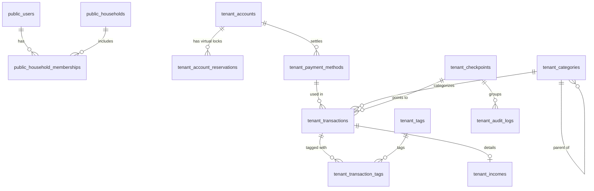

# 『Komame』データベース設計書（確定版）

## 1. データベース分離アーキテクチャ（PostgreSQL 16 スキーマ完全分離）

本システムは、**単一PostgreSQL 16データベース内で家庭ごとに専用スキーマを作成する「Schema per Tenant」方式**を採用します。

- **マスタ層 (`public` スキーマ)**: システム全体のユーザー認証、世帯マスター、世帯所属情報、全体システム設定。
- **テナント層 (`tenant_{household_id}` スキーマ)**: 各家庭の専用テーブル群（口座、明細、一時保存、貯蓄目標、監査ログ等）。
  - 山田家のテーブル: `tenant_yamada.transactions`, `tenant_yamada.accounts`
  - 佐藤家のテーブル: `tenant_sato.transactions`, `tenant_sato.accounts`
  - **他家庭のデータと同一テーブルに混在することは100%ありません**。

---

## 2. ERダイアグラム

---

## 3. テーブル定義一覧

### 3.1 マスタスキーマ (`public` スキーマ)

#### `public.users` (グローバル認証ユーザー)
| カラム名 | 型 | 制約 | 説明 |
| :--- | :--- | :--- | :--- |
| `id` | VARCHAR(36) | PK | ユーザーID (UUID v4) |
| `email` | VARCHAR(255) | UNIQUE, NOT NULL | メールアドレス (ログインID / 将来通知用) |
| `password_hash` | VARCHAR(255) | NOT NULL | ハッシュ化パスワード (Argon2id) |
| `theme_preference`| VARCHAR(50) | DEFAULT 'natural_komame' | 選択中のUIテーマ |
| `is_super_admin` | BOOLEAN | DEFAULT FALSE | 最上位システム管理者フラグ |
| `is_active` | BOOLEAN | DEFAULT TRUE | 有効/無効フラグ |
| `created_at` | TIMESTAMP | NOT NULL | 作成日時 |
| `updated_at` | TIMESTAMP | NOT NULL | 更新日時 |

#### `public.households` (システムアカウント / 世帯マスター)
| カラム名 | 型 | 制約 | 説明 |
| :--- | :--- | :--- | :--- |
| `id` | VARCHAR(36) | PK | 世帯ID (UUID v4) |
| `name` | VARCHAR(100) | NOT NULL | 世帯名 (例: 「山田家」) |
| `schema_name` | VARCHAR(63) | UNIQUE, NOT NULL | PostgreSQL専用スキーマ名 (例: `tenant_550e8400...`) |
| `created_at` | TIMESTAMP | NOT NULL | 作成日時 |

#### `public.household_memberships` (世帯所属・先行N:M互換)
| カラム名 | 型 | 制約 | 説明 |
| :--- | :--- | :--- | :--- |
| `id` | VARCHAR(36) | PK | 所属ID |
| `user_id` | VARCHAR(36) | FK(public.users.id), NOT NULL | ユーザーID |
| `household_id` | VARCHAR(36) | FK(public.households.id), NOT NULL | 世帯ID |
| `role` | VARCHAR(20) | NOT NULL | 世帯内権限 (`admin`: 家庭管理者 / `member`: 家庭メンバー) |
| `status` | VARCHAR(20) | DEFAULT 'active' | 状態 (`active` / `inactive` [論理削除]) |
| `is_default` | BOOLEAN | DEFAULT TRUE | デフォルト世帯フラグ |
| `joined_at` | TIMESTAMP | NOT NULL | 参加日時 |

#### `public.system_settings` (システム・世帯設定)
| カラム名 | 型 | 制約 | 説明 |
| :--- | :--- | :--- | :--- |
| `household_id` | VARCHAR(36) | FK(public.households.id), NULLABLE | 世帯ID (NULLなら全社共通デフォルト) |
| `key` | VARCHAR(50) | NOT NULL | 設定キー (`currency_symbol`, `password_policy`, `date_format`) |
| `value_json` | JSONB | NOT NULL | 設定値 (JSON) |
| `updated_at` | TIMESTAMP | NOT NULL | 最終更新日時 |

---

### 3.2 テナント専用スキーマ (`tenant_{id}` スキーマ)

#### `tenant_xxx.accounts` (資産・口座・ウォレット)
| カラム名 | 型 | 制約 | 説明 | 削除ポリシー |
| :--- | :--- | :--- | :--- | :--- |
| `id` | VARCHAR(36) | PK | 口座ID | - |
| `name` | VARCHAR(100) | NOT NULL | 口座名 (例: 「三井住友銀行 本支店」「PayPay」) | - |
| `type` | VARCHAR(30) | NOT NULL | 種別 (`bank`, `prepaid_wallet`, `cash`, `term_deposit`, `nisa_investment`) | - |
| `balance` | BIGINT | NOT NULL, DEFAULT 0 | 現在残高 (円) | - |
| `icon` | VARCHAR(50) | | アイコン識別子 | - |
| `color` | VARCHAR(20) | | カラーコード | - |
| `sort_order` | INT | DEFAULT 0 | 並び順 | - |
| `is_active` | BOOLEAN | DEFAULT TRUE | 状態フラグ | **論理削除 (falseで非表示、過去明細は維持)** |

#### `tenant_xxx.account_reservations` (口座内バーチャル貯蓄・資金色分け)
| カラム名 | 型 | 制約 | 説明 |
| :--- | :--- | :--- | :--- |
| `id` | VARCHAR(36) | PK | 取り分け設定ID |
| `account_id` | VARCHAR(36) | FK(accounts.id), NOT NULL | 対象口座ID |
| `name` | VARCHAR(100) | NOT NULL | 色分け用途名 (例: 「車検用積立」「緊急防衛資金」) |
| `amount` | BIGINT | NOT NULL | ロック金額 (円) |
| `color` | VARCHAR(20) | | 表示カラー |
| `created_at` | TIMESTAMP | NOT NULL | 作成日時 |

> **実質利用可能残高** = `accounts.balance` - `SUM(account_reservations.amount)`

#### `tenant_xxx.payment_methods` (支払い手段マスター)
| カラム名 | 型 | 制約 | 説明 | 削除ポリシー |
| :--- | :--- | :--- | :--- | :--- |
| `id` | VARCHAR(36) | PK | 決済手段ID | - |
| `name` | VARCHAR(100) | NOT NULL | 決済手段名 (例: 「楽天カード」「三井住友デビット」) | - |
| `type` | VARCHAR(30) | NOT NULL | 種別 (`cash`, `credit_card`, `debit_card`, `qr_code`, `direct_debit`) | - |
| `source_account_id`| VARCHAR(36) | FK(accounts.id) | 引き落とし元口座 / 決済元口座 | - |
| `closing_day` | INT | | 締め日 (1〜28, 99:月末) ※クレカのみ | - |
| `withdrawal_day` | INT | | 引き落とし日 (1〜28, 99:月末) ※クレカのみ | - |
| `withdrawal_month_offset` | INT | DEFAULT 1 | 引き落とし月 (0:当月, 1:翌月, 2:翌々月) | - |
| `is_active` | BOOLEAN | DEFAULT TRUE | 状態フラグ | **論理削除 (falseで非表示)** |

#### `tenant_xxx.categories` (費目マスター)
| カラム名 | 型 | 制約 | 説明 | 削除ポリシー |
| :--- | :--- | :--- | :--- | :--- |
| `id` | VARCHAR(36) | PK | 費目ID | - |
| `name` | VARCHAR(100) | NOT NULL | 費目名 (例: 食費, 日用品, 住居費) | - |
| `parent_id` | VARCHAR(36) | FK(categories.id) | 親費目ID (階層分類用) | - |
| `icon` | VARCHAR(50) | | アイコン識別子 | - |
| `color` | VARCHAR(20) | | カラーコード | - |
| `sort_order` | INT | DEFAULT 0 | ソート順 | - |
| `is_archived` | BOOLEAN | DEFAULT FALSE | アーカイブフラグ | **論理削除 (trueで非表示、過去明細・グラフは維持)** |

#### `tenant_xxx.transactions` (明細データ)
| カラム名 | 型 | 制約 | 説明 | 削除ポリシー |
| :--- | :--- | :--- | :--- | :--- |
| `id` | VARCHAR(36) | PK | 明細ID | - |
| `user_id` | VARCHAR(36) | NOT NULL | 登録ユーザーID | - |
| `type` | VARCHAR(20) | NOT NULL | `expense` (支出), `income` (収入), `transfer` (資金移動) | - |
| `date` | DATE | NOT NULL | 決済・取引発生日 | - |
| `amount` | BIGINT | NOT NULL | 取引金額 (円) | - |
| `category_id` | VARCHAR(36) | FK(categories.id) | 費目ID | - |
| `payment_method_id`| VARCHAR(36) | FK(payment_methods.id) | 決済手段ID | - |
| `from_account_id` | VARCHAR(36) | FK(accounts.id) | 移動元口座 | - |
| `to_account_id` | VARCHAR(36) | FK(accounts.id) | 移動先口座 | - |
| `shop_name` | VARCHAR(150) | | 店舗名・取引先名 | - |
| `note` | TEXT | | 簡易メモ (レシート相違、個数等) | - |
| `is_settled` | BOOLEAN | DEFAULT FALSE | クレジットカード等の引き落とし完了フラグ | - |
| `scheduled_withdrawal_date` | DATE | | カード引き落とし予定日 | - |
| `checkpoint_id` | VARCHAR(36) | FK(checkpoints.id) | 所属チェックポイントID | - |
| `deleted_at` | TIMESTAMP | | 削除日時 | **論理削除 (NULL以外で非表示、監査ログから復元可)** |
| `created_at` | TIMESTAMP | NOT NULL | 登録日時 | - |
| `updated_at` | TIMESTAMP | NOT NULL | 更新日時 | - |

#### `tenant_xxx.drafts` (2段階一時保存)
- `id`, `user_id`, `draft_type` (`manual` / `auto`), `form_type` (`single` / `shop_batch` / `category_batch`), `payload_json`, `item_count`, `saved_at`
- **削除ポリシー**: 物理削除（上書き、破棄、24hリバート時にDELETE）

#### `tenant_xxx.savings_goals` (貯蓄目標)
- `id`, `title`, `target_amount`, `target_date`, `account_ids_json`, `color`, `is_completed`

#### `tenant_xxx.notifications` (アプリ内通知)
- `id`, `user_id`, `type`, `title`, `message`, `is_read`, `created_at`

#### `tenant_xxx.checkpoints` & `tenant_xxx.audit_logs` (24時間リバート & 監査ログ)
- `checkpoints`: ユーザーの操作群ごとに生成（有効期限: `created_at` + 24時間）。
- **リバート処理ロジック**:
  1. 指定チェックポイント以降の `transactions`（`deleted_at` 設定解除/削除）、`incomes` を該当状態にロールバック。
  2. 対象期間内の収支・振替による `accounts.balance` の変動を逆算・復元。
  3. **一時保存データのリセット**: `drafts` レコードを全件物理削除し、空状態に初期化。
  4. 同一家庭内の他メンバーへの影響サマリーを表示し二重確認。
