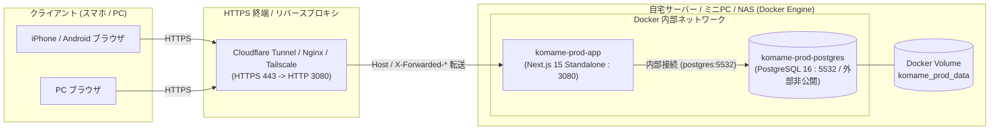

# 『Komame』本番環境・開発環境 構築および運用手順書

本ドキュメントは、家族向けマルチテナント家計簿 Web アプリケーション『**Komame**』を **自宅サーバー・ミニPC・NAS 等（家庭内 LAN や Tailscale 等の VPN 経由を含む）** に Docker Compose で構築し、**独自ドメイン＋HTTPS（SSL/TLS）** で安全に運用するための完全手順書です。

---

## 目次

1. [システム構成と全体アーキテクチャ](#1-システム構成と全体アーキテクチャ)
2. [本番環境の前提条件・推奨スペック](#2-本番環境の前提条件推奨スペック)
3. [本番環境の構築手順（ステップ・バイ・ステップ）](#3-本番環境の構築手順ステップバイステップ)
4. [独自ドメイン＋HTTPS化（SSL/TLS）の構成手順](#4-独自ドメインhttps化ssltlsの構成手順)
   - [方式A（推奨）: Cloudflare Tunnel による HTTPS 化（ルーターのポート開放不要）](#方式a推奨-cloudflare-tunnel-による-https-化ルーターのポート開放不要)
   - [方式B: Nginx リバースプロキシ ＋ Let's Encrypt (Certbot) による HTTPS 化](#方式b-nginx-リバースプロキシ--lets-encrypt-certbot-による-https-化)
   - [方式C: Tailscale (VPN) ＋ Tailscale Serve / HTTPS 証明書による閉域網 HTTPS 化](#方式c-tailscale-vpn--tailscale-serve--https-証明書による閉域網-https-化)
5. [初期セットアップ（世帯・管理者アカウントの作成と家族招待）](#5-初期セットアップ世帯管理者アカウントの作成と家族招待)
6. [日常運用・保守（DBバックアップ / リストア / アップデート）](#6-日常運用保守dbバックアップ--リストア--アップデート)
7. [ログ監視・スロークエリ検知・トラブルシューティング](#7-ログ監視スロークエリ検知トラブルシューティング)
8. [開発環境のセットアップ手順 (Windows 10 / 11)](#8-開発環境のセットアップ手順-windows-10--11)

---

## 1. システム構成と全体アーキテクチャ

本番環境では Docker Compose（`docker-compose.prod.yml`）を使用し、アプリケーションコンテナとデータベースコンテナを内部ネットワークで安全に連携させます。



### ポート構成とセキュリティ上の重要仕様
| サービス | コンテナ名 | ホスト側ポート | コンテナ内ポート | 備考 |
| :--- | :--- | :--- | :--- | :--- |
| **Next.js アプリ** | `komame-prod-app` | `3080` | `3080` | リバースプロキシまたはトンネルから転送 |
| **PostgreSQL 16** | `komame-prod-postgres` | **非公開** | `5532` | ホスト外部からは直接アクセス不可（内部通信のみ） |

> [!IMPORTANT]
> **本番環境（`NODE_ENV=production`）における 3 つのセキュリティ強制仕様**
> 1. **Fail-Fast シークレット検証**: `JWT_SECRET` が未設定、32文字未満、またはサンプル初期値のままの場合、コンテナ起動時にエラーで停止します。
> 2. **Secure Cookie 属性**: セッション Cookie（`komame_session`）に `Secure` 属性が付与されるため、スマホや別 PC のブラウザからログインするには **HTTPS 通信が必須** です。
> 3. **CSRF Origin / Host 検証**: 状態変更 API（`POST` / `PUT` / `DELETE`）ではリクエストの `Origin` ヘッダーと `Host`（または `X-Forwarded-Host`）ヘッダーの一致を検証します。リバースプロキシ利用時は `Host` ヘッダーを正しく転送する必要があります。

---

## 2. 本番環境の前提条件・推奨スペック

### ハードウェア目安（自宅ミニPC・NAS・Raspberry Pi 等）
- **CPU**: x86_64（Intel N100 / Core i3 等）または ARM64（2コア以上推奨）
- **メモリ (RAM)**: 2GB 以上（推奨 4GB 以上）
- **ストレージ**: 空き容量 10GB 以上（SSD 推奨）
- **OS**: Ubuntu 22.04 / 24.04 LTS、Debian 12、または Docker 対応 NAS OS（Synology DSM / QNAP QTS / TrueNAS 等）

### 必要なソフトウェア
- **Docker Engine**: v24.0 以上
- **Docker Compose**: v2.20 以上（`docker compose` コマンド）
- **Git** および **OpenSSL**（シークレット生成用）

```bash
# バージョン確認コマンド
docker --version
docker compose version
git --version
openssl version
```

---

## 3. 本番環境の構築手順（ステップ・バイ・ステップ）

### Step 1: ソースコードの配置
本番サーバーの任意のディレクトリ（例: `/opt/komame` または `~/komame`）にリポジトリをクローンします。

```bash
sudo mkdir -p /opt/komame
sudo chown $USER:$USER /opt/komame
git clone <リポジトリURL> /opt/komame
cd /opt/komame
```

### Step 2: 本番用環境変数ファイル (`.env.production`) の作成とシークレット生成
テンプレート `.env.production.example` をコピーして `.env.production` を作成し、アクセス権限を制限します。

```bash
cp .env.production.example .env.production
chmod 600 .env.production
```

次に、`openssl` コマンドで安全なランダム文字列を生成し、`.env.production` に設定します。

```bash
# 1. PostgreSQL パスワード用のランダム文字列を生成 (48文字の16進数)
openssl rand -hex 24

# 2. JWT_SECRET 用のランダム文字列を生成 (64文字のBase64文字列)
openssl rand -base64 48
```

`.env.production` をエディタ（`nano .env.production` 等）で開き、生成した値を貼り付けます。

```ini
# 1. PostgreSQL 16 データベース設定
POSTGRES_USER=komame_prod_user
POSTGRES_PASSWORD=ここに「openssl rand -hex 24」の出力値を貼り付け
POSTGRES_DB=komame_prod_db

# 2. JWT セッション暗号化シークレットキー (32文字以上必須)
JWT_SECRET=ここに「openssl rand -base64 48」の出力値を貼り付け

# 3. アプリケーション基本設定
PORT=3080
LOG_LEVEL=info

# 4. 初期セットアップ（デモ/初期シード実行時のみ使用）
DEFAULT_ADMIN_EMAIL=admin@example.com
DEFAULT_ADMIN_PASSWORD=InitialStrongPass123!
DEFAULT_HOUSEHOLD_NAME=わが家の家計簿
```

> [!TIP]
> Docker Compose のコマンド実行時に毎回 `--env-file .env.production` を指定する手間を省きたい場合は、シンボリックリンク `ln -s .env.production .env` を作成しておくと自動で読み込まれます。

### Step 3: Docker コンテナのビルドと起動
以下のコマンドで Next.js のマルチステージビルド（Standalone 出力）と PostgreSQL 16 コンテナを起動します。

```bash
docker compose --env-file .env.production -f docker-compose.prod.yml up -d --build
```

起動状態とヘルスチェックを確認します。

```bash
docker compose --env-file .env.production -f docker-compose.prod.yml ps
```
`komame-prod-postgres` が `healthy`、`komame-prod-app` が `Up` になっていれば正常です。

### Step 4: データベースマイグレーションの実行
本番データベースにマスタスキーマ（`public`）およびテナントスキーマ構造を反映します。

```bash
docker compose --env-file .env.production -f docker-compose.prod.yml exec app npm run db:migrate
```

出力に `🎉 Database migration completed successfully!` と表示されれば、データベースの準備は完了です。

---

## 4. 独自ドメイン＋HTTPS化（SSL/TLS）の構成手順

自宅サーバー・ミニPC 環境で独自ドメイン＋HTTPS を実現する代表的な **3つの方式** を記載します。ご自身のネットワーク環境に合わせて **いずれか1つ** を選択してください。

---

### 方式A（推奨）: Cloudflare Tunnel による HTTPS 化（ルーターのポート開放不要）

自宅ルーターのポート開放（80番/443番）や固定グローバルIPが不要で、マンション回線や IPv6 IPoE（MAP-E / DS-Lite）環境でも独自ドメイン＋自動 HTTPS 化が完了する最も手軽で安全な構成です。

1. **Cloudflare Zero Trust ダッシュボード**（`Networks` > `Tunnels`）で新規トンネル（Cloudflared）を作成します。
2. 自宅サーバーに `cloudflared` をインストールしてサービス登録するか、`docker-compose.prod.yml` と同じマシンで起動します。
3. **Public Hostname（公開ホスト名）** に以下を設定します：
   - **Subdomain / Domain**: 例 `komame.example.com`
   - **Service Type**: `HTTP`
   - **URL**: `localhost:3080`（同一ホスト上で `cloudflared` を動かしている場合）
4. Cloudflare 側で自動的に SSL/TLS 証明書が発行され、`https://komame.example.com` でスマホ・PC から安全にアクセスできます。
   - ※ Cloudflare Access（ワンタイムPIN認証やGoogleアカウント制限）を前段に挟むことで、家族以外のアクセスをエッジ側で完全遮断することも可能です。

---

### 方式B: Nginx リバースプロキシ ＋ Let's Encrypt (Certbot) による HTTPS 化

自宅内の DNS（ローカル DNS / AdGuard Home / ルーターのホスト設定）や DDNS を使い、自宅サーバー上の Nginx で HTTPS 終端を行う構成です。

#### 1. Nginx と Certbot のインストール
```bash
sudo apt update
sudo apt install -y nginx certbot python3-certbot-nginx
```

#### 2. Nginx 設定ファイル (`/etc/nginx/sites-available/komame.conf`) の作成
Komame の CSRF 検証（`src/lib/csrf.ts`）および IP レートリミッター（`src/lib/rate-limit.ts`）が正しく機能するよう、**`Host`、`X-Forwarded-Host`、`X-Forwarded-For`、`X-Forwarded-Proto` ヘッダーを必ず転送** します。

```nginx
server {
    listen 80;
    server_name komame.example.com;

    # CSV インポートの最大ファイルサイズ (5MB) に合わせて上限を設定
    client_max_body_size 10M;

    location / {
        proxy_pass http://127.0.0.1:3080;
        proxy_http_version 1.1;

        # WebSocket / Keep-Alive 対応
        proxy_set_header Upgrade $http_upgrade;
        proxy_set_header Connection 'upgrade';
        proxy_cache_bypass $http_upgrade;

        # 【重要】CSRF Origin/Host 検証およびレートリミッター用のヘッダー転送
        proxy_set_header Host $host;
        proxy_set_header X-Forwarded-Host $host;
        proxy_set_header X-Real-IP $remote_addr;
        proxy_set_header X-Forwarded-For $proxy_add_x_forwarded_for;
        proxy_set_header X-Forwarded-Proto $scheme;
    }
}
```

#### 3. 設定の有効化と SSL 証明書の取得
```bash
sudo ln -s /etc/nginx/sites-available/komame.conf /etc/nginx/sites-enabled/
sudo nginx -t
sudo systemctl reload nginx

# Let's Encrypt で証明書を取得し、自動で HTTPS リダイレクトを設定
sudo certbot --nginx -d komame.example.com
```
※ 家庭内 LAN 専用で外部から 80 番ポートに到達できない場合は、`certbot certonly --manual --preferred-challenges dns`（DNS-01 チャレンジ）を使用するとポート開放なしで正規の Let's Encrypt 証明書を取得できます。

---

### 方式C: Tailscale (VPN) ＋ Tailscale Serve による閉域網 HTTPS 化

外部インターネットには一切公開せず、家族のスマホ・PC に **Tailscale** アプリを入れて VPN 経由でのみアクセスする構成です。

1. Tailscale Admin Console の **DNS** 設定で **MagicDNS** と **HTTPS Certificates** を有効化します。
2. 自宅サーバー上で以下のコマンドを実行し、ローカルの `3080` 番ポートを Tailscale ネットワーク内の HTTPS（443番）として公開します：
   ```bash
   sudo tailscale serve --bg 3080
   ```
3. 自動的に Let's Encrypt 証明書がプロビジョニングされ、`https://<マシン名>.<tailnet名>.ts.net` で HTTPS アクセスが可能になります。

---

## 5. 初期セットアップ（世帯・管理者アカウントの作成と家族招待）

データベースのマイグレーション完了後、以下の手順で初期システム管理者（Super Admin）アカウントの作成、新規世帯申請の承認、および家族メンバーの招待を行います。

> [!IMPORTANT]
> **初期デモ管理者アカウント（`admin@komame.local`）の本番環境での無効化について**  
> 初期デモ管理者アカウント（`admin@komame.local` / `Password123!`）は **テスト環境（`NODE_ENV !== "production"`）限定** で有効です。本番環境（`NODE_ENV=production`）では、セキュリティ保護のためログイン・セッション検証・シード作成のすべてにおいて初期デモ資格情報は拒否され、ログイン画面にもデモアカウント案内は一切表示されません。

### Step 1: 初期システム管理者（Super Admin）世帯のシード作成
本番環境では、`.env.production` に設定した独自の `DEFAULT_ADMIN_EMAIL` / `DEFAULT_ADMIN_PASSWORD` / `DEFAULT_HOUSEHOLD_NAME` を用いて、最初のシステム管理者（`is_super_admin = TRUE`）および承認済み世帯をシード投入します。

```bash
docker compose --env-file .env.production -f docker-compose.prod.yml exec app npm run db:seed
```

### Step 2: 新規世帯登録の申請とシステム管理者による承認（許可制）
別世帯を Web 画面から追加登録する場合、登録は **申請・許可制** となります。

1. ブラウザで `https://<あなたのドメイン>` にアクセスします。
2. ログイン画面の **「新規世帯登録（申請）」** タブを開き、**世帯名**、**メールアドレス**、**パスワード** を入力して登録を申請します（この時点では承認待ち `pending` 状態となり、まだログインや専用スキーマ作成は行われません）。
3. システム管理者（Super Admin）アカウントでログインし、**「管理・設定」** タブ内の **「システム管理：新規世帯登録の承認・アカウント管理」** セクションから該当申請を **「許可（承認）」** します。
4. 承認と同時に世帯専用のテナントスキーマ（`tenant_xxx`）と日本の標準費目マスター（12種）・初期現金口座が自動生成され、申請者がログイン可能になります。

### Step 3: 家族メンバーの招待方法（システム管理者の追加許可不要）
承認済み世帯への家族メンバーの追加は、世帯管理者（`Household Admin`）の招待により即座に有効化されます。

1. 世帯管理者アカウントでログインし、画面上部のナビゲーション（スマホでは下部タブ）から **「管理・設定」** タブを開きます。
2. **「家族メンバー管理」** セクションの **「＋ メンバーを招待」** をクリックします。
3. 権限（`メンバー` または `管理者`）を選択して **招待リンク（7日間有効）** を発行し、LINE やメール等で家族に共有します。
4. 家族が招待リンク（`https://<あなたのドメイン>/invite?token=...`）を開き、メールアドレスとパスワードを設定すると、同じ世帯の家計簿に即座に参加できます。

---

## 6. 日常運用・保守（DBバックアップ / リストア / アップデート）

### 6.1 データベースのバックアップ (`pg_dump`)
Komame のデータはマスタ（`public`）および全世帯スキーマ（`tenant_*`）すべて単一の PostgreSQL データベース（`komame_prod_db`）内に格納されています。`pg_dump` 1回で全世帯のデータを完全バックアップできます。

```bash
# バックアップ保存用ディレクトリの作成
mkdir -p /opt/komame/backups

# 現在日時付きで圧縮 SQL ダンプを出力
docker compose --env-file .env.production -f docker-compose.prod.yml exec -T postgres \
  pg_dump -p 5532 -U komame_prod_user -d komame_prod_db --clean --if-exists \
  | gzip > "/opt/komame/backups/komame_backup_$(date +%Y%m%d_%H%M%S).sql.gz"
```

#### 自動定期バックアップ（cron 設定例: 毎日深夜 3:00 に実行し、30日分保持）
`crontab -e` を開き、以下を追加します：

```cron
0 3 * * * cd /opt/komame && docker compose --env-file .env.production -f docker-compose.prod.yml exec -T postgres pg_dump -p 5532 -U komame_prod_user -d komame_prod_db --clean --if-exists | gzip > /opt/komame/backups/komame_backup_$(date +\%Y\%m\%d).sql.gz && find /opt/komame/backups -name "komame_backup_*.sql.gz" -mtime +30 -delete
```

### 6.2 データベースのリストア（復元）手順
万が一の障害時やサーバー移行時は、以下のコマンドでバックアップファイルから完全復元できます。

```bash
gunzip -c /opt/komame/backups/komame_backup_YYYYMMDD_HHMMSS.sql.gz | \
  docker compose --env-file .env.production -f docker-compose.prod.yml exec -T postgres \
  psql -p 5532 -U komame_prod_user -d komame_prod_db
```

### 6.3 アプリケーションのアップデート手順
新しいバージョンのソースコードを取り込んで本番環境を更新する手順です。

```bash
cd /opt/komame

# 1. 念のためアップデート前にDBバックアップを取得
docker compose --env-file .env.production -f docker-compose.prod.yml exec -T postgres \
  pg_dump -p 5532 -U komame_prod_user -d komame_prod_db --clean --if-exists \
  | gzip > "/opt/komame/backups/pre_update_$(date +%Y%m%d_%H%M%S).sql.gz"

# 2. 最新コードの取得
git pull origin main

# 3. アプリケーションイメージの再ビルドとコンテナ再作成
docker compose --env-file .env.production -f docker-compose.prod.yml up -d --build

# 4. スキーマ変更がある場合に備えてマイグレーションを実行 (べき等性あり・何度実行しても安全)
docker compose --env-file .env.production -f docker-compose.prod.yml exec app npm run db:migrate
```

---

## 7. ログ監視・スロークエリ検知・トラブルシューティング

### 7.1 アプリケーションログの確認
Pino による構造化 JSON ログが出力されます。

```bash
# リアルタイムでログを追跡
docker compose --env-file .env.production -f docker-compose.prod.yml logs -f app

# エラーログのみを抽出
docker compose --env-file .env.production -f docker-compose.prod.yml logs app | grep '"level":50'
```

### 7.2 スロークエリの自動検知（200ms 閾値）
DB クエリの実行時間が `200ms` を超えると、自動的に `SLOW_QUERY_DETECTED` 警告ログが記録されます。

```bash
docker compose --env-file .env.production -f docker-compose.prod.yml logs app | grep "SLOW_QUERY_DETECTED"
```

### 7.3 よくあるトラブルと解決方法 (FAQ)

| 症状・エラー内容 | 原因 | 解決方法 |
| :--- | :--- | :--- |
| **コンテナ起動直後に `【セキュリティ違反】本番環境では JWT_SECRET...` で停止する** | `.env.production` の `JWT_SECRET` が未設定、32文字未満、または `.env.example` のサンプル値のままになっている | `openssl rand -base64 48` で生成した32文字以上のランダム文字列を `.env.production` の `JWT_SECRET` に設定して再起動してください。 |
| **ログインには成功するが、直後に未ログイン状態に戻ってしまう** | HTTPS ではなく HTTP（`http://192.168.x.x:3080` 等）でアクセスしており、ブラウザが `Secure` 属性付き Cookie を拒否している | 第4章の手順に従い、Cloudflare Tunnel / Nginx / Tailscale Serve 等で **HTTPS 経由** でアクセスしてください。 |
| **ログインや明細登録時に `403 Forbidden (CSRF 検証に失敗しました)` が出る** | リバースプロキシ（Nginx等）が `Host` や `X-Forwarded-Host` ヘッダーを転送しておらず、ブラウザの `Origin` と不一致になっている | Nginx の `location /` ブロックに `proxy_set_header Host $host;` および `proxy_set_header X-Forwarded-Host $host;` を設定してリロードしてください。 |
| **連続してログイン試行した際に `429 Too Many Requests` が出る** | ブルートフォース防御のレートリミッター（1分間に同一アカウント5回・同一IP 10回）が作動している | 1分待ってから再試行してください。また、Nginx 経由の場合は全ユーザーが同一IP（`127.0.0.1`）と判定されないよう `proxy_set_header X-Forwarded-For $proxy_add_x_forwarded_for;` を設定してください。 |

---

## 8. 開発環境のセットアップ手順 (Windows 10 / 11)

ローカル開発・動作検証用の環境構築手順です。

```powershell
# 1. 依存パッケージのインストール
npm install

# 2. 開発用環境変数の準備
Copy-Item .env.example .env.local

# 3. 開発用 PostgreSQL 16 コンテナの起動 (ポート 5532)
npm run db:up

# 4. マスタスキーマおよびテナントスキーマのマイグレーション
npm run db:migrate

# 5. デモデータ（山田家・初期口座・サンプル明細）のシード投入
npm run db:seed

# 6. 開発サーバーの起動 (ポート 3080)
npm run dev
```

- **開発環境 URL**: `http://localhost:3080`
- **デモ用ログイン**: `admin@komame.local` / `Password123!`

---

## 9. 改訂履歴

- **2026-11-19**: 第5章「初期セットアップ」に、新規世帯登録の申請・許可制フロー（Super Admin による承認手順）および初期デモ管理者アカウント（`admin@komame.local`）のテスト環境限定有効化・本番環境での無効化仕様を反映。
- **2026-11-14**: 自宅サーバー・ミニPC・NAS＋独自ドメイン HTTPS 化（Cloudflare Tunnel / Nginx + Let's Encrypt / Tailscale Serve）に向けた本番環境構築手順書として全面拡充。シークレット生成手順、初期セットアップ、DB バックアップ・リストア、アップデート手順、トラブルシューティングを追記。
- **2026-10-18**: 開発・本番環境のポート番号をアプリケーション: `3080`、PostgreSQL: `5532` に統一改訂し、アクセス先URLおよび起動ポート記載を更新。
