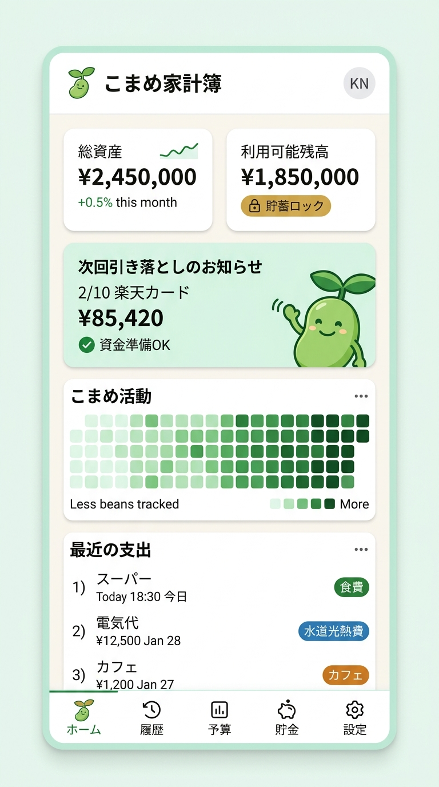
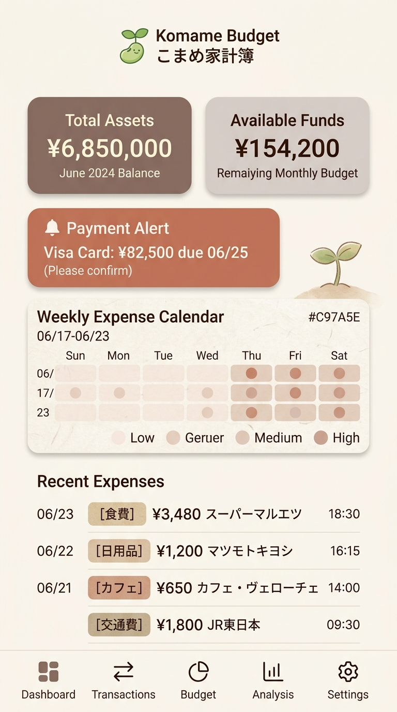
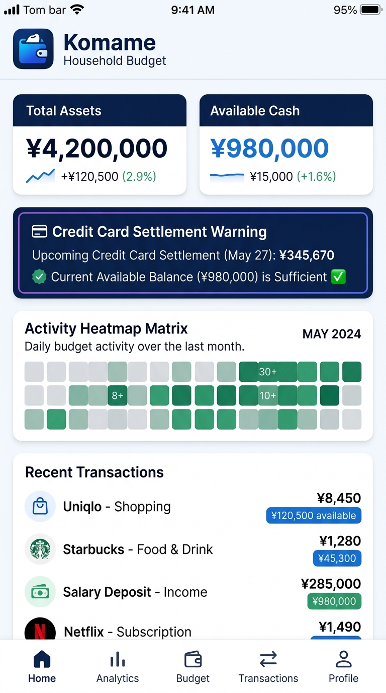
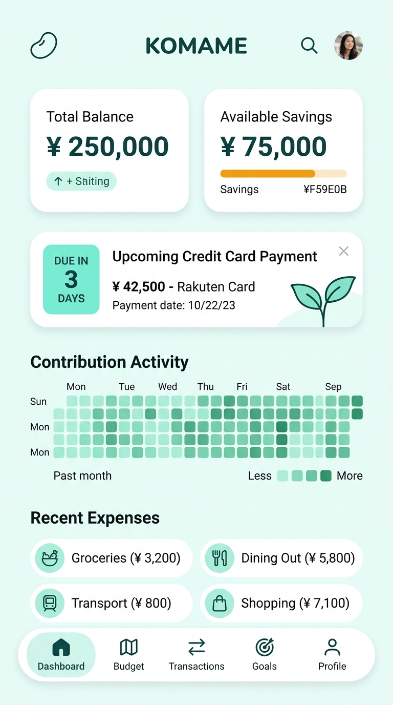
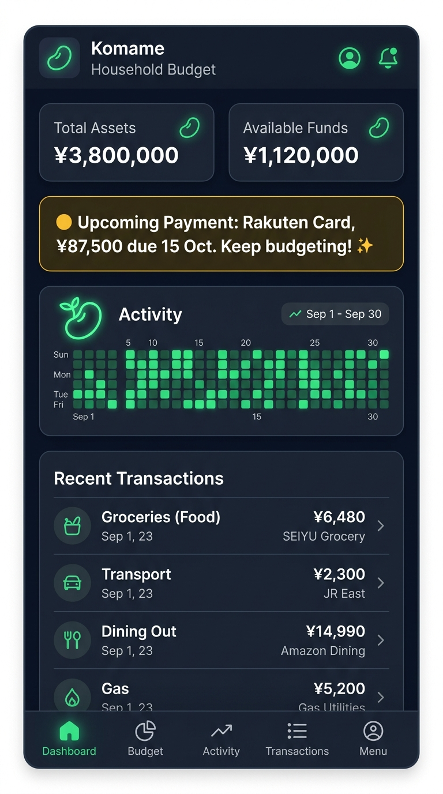

# 『Komame』UI/UX設計・確定ロゴ・5大テーマ画面イメージ・ゲーミフィケーション設計書（確定版）

> [!TIP]
> ### 🌐 インタラクティブHTMLモックアップ（ブラウザで動作確認可能）
> ブラウザで直接操作し、**5大テーマの即時切替、ダッシュボード、明細登録（サジェスト＆自動保存）、口座色分け、24hリバート**を体験できるHTMLプロトタイプを作成・配置しました。
> - **モックアップを開く**: [mockup/index.html をブラウザで直接開く](file:///c:/Users/ina90/Documents/Workspace/Komame/mockup/index.html)

---

## 1. 採用ロゴ「Komame」（パターン 1-A: 芽吹く豆と資産の手）

「こまめ（豆）」「資産・記録が芽吹く新芽」「家計とお金を優しく包む手・コイン」をモチーフにした、親しみやすさと躍動感のあるシンボルを採用決定しました。

- **メインモチーフ**: ぷっくりとした豆から右上へすくすく伸びる新芽 ＋ 下部から家計と資産を支えるゴールドの手・コイン
- **配置先**: [docs/assets/komame_logo.jpg](file:///c:/Users/ina90/Documents/Workspace/Komame/docs/assets/komame_logo.jpg)

---

## 2. 5大画面デザインテーマの画面イメージ（全テーマ作成完了）

ユーザーが気分や好みに合わせていつでも即時切替可能な5つの洗練されたカラー＆タイポグラフィテーマです。

### 📱 テーマ 1: **Natural Komame（ナチュラル・まめグリーン）** 【初期デフォルト確定】
- **コンセプト**: アプリのアイデンティティである「こまめ・新芽の緑・大地の温もり」を表現した、親しみやすく明るいオーガニックデザイン。
- **カラーパレット**:
  - メインカラー: `#2E7D32`（フレッシュな枝豆グリーン）
  - サブカラー: `#81C784`（若葉グリーン）
  - アクセント: `#E6A15C`（温かみのあるゴールド・麦色）
  - 背景色: `#F9FBF8`（ほんのり生成りのオフホワイト）
  - テキスト: `#1E2B20`（深みのあるフォレストグレー）
- **画面イメージ** ([直接開く](file:///c:/Users/ina90/Documents/Workspace/Komame/docs/assets/theme_1_natural_komame.jpg)):

---

### 📱 テーマ 2: **Warm Latte & Washi（和モダン・温もりラテ）**
- **コンセプト**: 和紙やカフェラテのような落ち着いたベージュ・木目調の温もりを基調とした、シンプルで心地よい暮らしの家計簿。
- **カラーパレット**:
  - メインカラー: `#8D6E63`（ウォームラテブラウン）
  - サブカラー: `#D7CCC8`（リネンベージュ）
  - アクセント: `#C97A5E`（テラコッタ）
  - 背景色: `#FAF7F2`（和紙オフホワイト）
  - テキスト: `#3E2723`（エスプレッソダーク）
- **画面イメージ** ([直接開く](file:///c:/Users/ina90/Documents/Workspace/Komame/docs/assets/theme_2_warm_latte.jpg)):

---

### 📱 テーマ 3: **Modern FinTech Indigo（洗練・インディゴブルー）**
- **コンセプト**: 信頼性とクリアな視認性を極めた、現代的でプレミアムなフィンテックデザイン。
- **カラーパレット**:
  - メインカラー: `#1A365D`（ディープインディゴ）
  - サブカラー: `#3182CE`（スマートブルー）
  - アクセント: `#38A169`（資産プラスグリーン）
  - 背景色: `#F7FAFC`（クールホワイト）
  - テキスト: `#2D3748`（スレートグレー）
- **画面イメージ** ([直接開く](file:///c:/Users/ina90/Documents/Workspace/Komame/docs/assets/theme_3_fintech_indigo.jpg)):

---

### 📱 テーマ 4: **Forest & Mint Clean（深呼吸フォレスト・北欧風）**
- **コンセプト**: 北欧の針葉樹林とミントの清涼感をイメージした、洗練されたミニマリズム。
- **カラーパレット**:
  - メインカラー: `#134E4A`（ディープティール）
  - サブカラー: `#5EEAD4`（ミントアイス）
  - アクセント: `#F59E0B`（アンバーオレンジ）
  - 背景色: `#F0FDFA`（ペールミントホワイト）
  - テキスト: `#042F2E`（ディープエメラルドブラック）
- **画面イメージ** ([直接開く](file:///c:/Users/ina90/Documents/Workspace/Komame/docs/assets/theme_4_forest_mint.jpg)):

---

### 📱 テーマ 5: **Slate Minimal Dark（目に優しいスレートダーク）**
- **コンセプト**: 夜間の家計簿付けや暗所でも目が疲れない、低コントラストで上品なダークモード。
- **カラーパレット**:
  - メインカラー: `#1E293B`（スレートサーフェス）
  - サブカラー: `#334155`（エレメントボーダー）
  - アクセント: `#4ADE80`（ネオンエメラルド）/ `#FBBF24`（ゴールド）
  - 背景色: `#0F172A`（ディープネイビーブラック）
  - テキスト: `#F8FAFC`（ハイコントラストホワイト）
- **画面イメージ** ([直接開く](file:///c:/Users/ina90/Documents/Workspace/Komame/docs/assets/theme_5_slate_dark.jpg)):

---

## 3. UI/UX 設計思想・スマートフォン最優先のレイアウト設計

### 3.1 モバイルファーストの画面設計（iPhone・スマホ重視）
本アプリケーションは、**日々のレシート登録や残高確認の大半がスマートフォンから行われる**ことを前提に設計します。

1. **スマート・ヘッダー & スクロール連動アクションバー**:
   - 下方へスクロールすると上部ナビゲーションバーがスッと隠れ、コンテンツ表示領域を最大化（ビューポートの有効活用）。
   - 上方へ少しスワイプするか最上部へ戻るとヘッダーが自然に再出現。
2. **親指リーチ（Thumb Zone）に配置したボトムナビゲーション**:
   - 画面下部に主要導線（「📊 ダッシュボード」「➕ 記帳（中心強調）」「💳 口座・カード」「🌱 成長・目標」「⚙️ 設定」）を配置。
   - 片手操作で親指が届く範囲に最重要アクションを集中。
3. **入力ストレスを極限まで減らす「スマートフォーム」**:
   - 数値入力欄は自動でテンキー（数値キーボード）を起動。
   - 店舗名入力で自動的に過去の費目・支払元をサジェスト（1タップ確定）。
   - ポップアップやボトムシート（下からせり上がるドロワー）によるスムーズな選択体験。

---

## 4. 家計簿付けを楽しく続ける「Komame ゲーミフィケーション」

1. **こまめ草生やし（Activity Bean Heatmap）**: 支出や資金移動を記録した日に緑色の「豆アイコン（● / 🌱）」がカレンダーに点灯し、ストリーク日数を表示。
2. **まめの樹（Bean Sprout）育成システム**: 記録や貯蓄目標への接近に応じて、画面上の「こまめちゃん（豆の新芽）」がすくすく成長。
3. **スマート・アドバイス & やさしいほめ言葉**: 予算内達成時に温かいポジティブメッセージを通知。
4. **こまめアチーブメント（バッジコレクション）**: 「原資チェックマスター」「月間貯蓄クリア」等のバッジアンロック。

---

## 5. 専門知識ゼロでも迷わない「資金フロー & 色分け」可視化UI

1. **直感的な「資金パイプライン」**: 収入 → 口座 → （色分け貯蓄ロック） → カード決済 → 支払い というお金の流れを直感図解。
2. **引き落とし日カウントダウン・シグナル**:
   - 口座残高が足りている場合: **青/緑色の「資金準備完了（残高 ¥120,000）」**。
   - 色分け貯蓄を除くと足りない場合: **黄色の「注意: 貯蓄除きで¥5,000不足（提案: 貯蓄取り崩し または 他行から移動）」**。
   - 口座全体でも足りない場合: **赤色の「要資金移動（不足額 ¥15,000）」** と3段階シグナルで明示。
