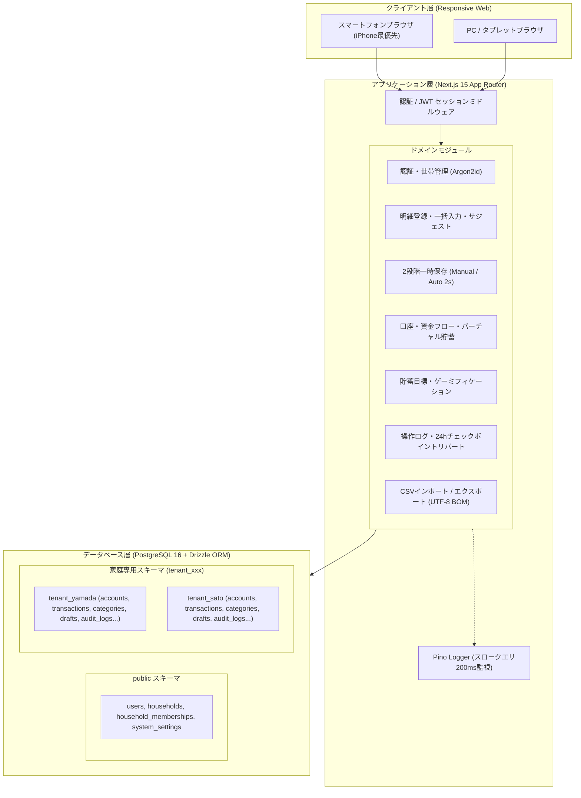

# 『Komame』システムアーキテクチャ・技術スタック設計書

## 1. マルチテナント・スキーマ完全分離アーキテクチャ

本システムは、**単一PostgreSQL 16データベース内で家庭ごとに専用スキーマを作成する「Schema per Tenant」方式**を採用しています。



### 1.1 動的スキーマ解決と接続プール共有
- **共通接続プール**: 全世帯で単一の共通PostgreSQL接続プール（最大30コネクション）を共有。
- **動的ルーティング**: APIリクエスト受信時、Cookieに格納されたJWTトークンから `activeHouseholdId` と `schemaName` を取得。
- **スキーマキャッシュ**: `getTenantSchema(schemaName)` により、同一スキーマのテーブル定義オブジェクトをキャッシュして再利用。
- **クエリ実行オーバーヘッド**: スキーマ切り替えによる遅延は `0ms〜0.2ms` であり、接続数の無駄遣いを防止。

---

## 2. 認証・認可 & セキュリティ設計

### 2.1 パスワードハッシュ化 (Argon2id)
- アルゴリズム: `Argon2id` (RFC 9106推奨)
- パラメータ設定:
  - `memoryCost`: 19,456 KiB
  - `timeCost`: 2
  - `parallelism`: 1
  - `outputLen`: 32 bytes

### 2.2 セッション管理 (JWT + HttpOnly Cookie)
- **Cookie属性**:
  - `name`: `komame_session`
  - `httpOnly`: true（JavaScriptからのXSS読取遮断）
  - `secure`: 本番環境時 true
  - `sameSite`: 'lax'（CSRF対策）
  - `maxAge`: 7日間（60 * 60 * 24 * 7 秒）
- **ペイロード構造**:
  ```typescript
  interface SessionPayload {
    userId: string;
    email: string;
    activeHouseholdId: string;
    schemaName: string;
    role: "admin" | "member";
  }
  ```

### 2.3 動的テナントスキーマ名のホワイトリスト検証 (assertValidSchemaName)
- **SQL インジェクション完全根絶 (VULN-01 / VULN-05)**:
  - テナントスキーマ名に不正な文字列や複文（Stacked Queries）が混入することを防ぐため、正規表現 `/^tenant_[a-zA-Z0-9_-]{1,55}$/` によるホワイトリスト検証を全テナントDB接続関数（`getTenantSchema`, `getTenantDb`, `createTenantTables`）の入口で強制実行。
  - Drizzle ORM の型安全クエリおよびパラメータバインディングを徹底し、`raw.unsafe(...)` による口座残高直接更新を完全廃止。

### 2.4 DB 突合によるリアルタイム権限検証とセッション即時失効 (VULN-06)
- **リアルタイム認可**:
  - `getCurrentSession()` において JWT 署名検証後、マスタDBの `users`（`isActive === true`）、`households`（`status === "approved"`）、および `household_memberships`（`status === "active"`）を照会。
  - メンバーの無効化（論理削除）、ロール変更（`admin` ↔ `member`）、またはシステム管理者による世帯アカウント停止（`suspended`）が即座に API リクエストに反映・遮断される。
  - 最上位管理者権限（`isSuperAdmin`）も DB 上の `users.isSuperAdmin` を都度照合して判定する。
- **セッション即時失効**:
  - ログアウト時（`POST /api/auth/logout`）およびパスワード変更・リセット時にセッションを即時無効化。

### 2.5 スライディングウィンドウ方式レートリミッター (VULN-08)
- **ブルートフォース & DoS 防御**:
  - `src/lib/rate-limit.ts` によるインメモリ・スライディングウィンドウ方式のレートリミットを実装。
  - ログイン（IPごと 10回/分、アカウントごと 5回/分）、サインアップ申請（スパム申請・DoS 防御: 5回/分）、招待（10回/分）を制限し、超過時は `429 Too Many Requests` と `Retry-After` ヘッダーを返却。
  - なお、新規世帯登録申請は承認制のため、未承認状態ではテナントスキーマを作成せず、システム管理者の承認時にのみスキーマを生成する多層防御を採用している。

### 2.6 HTTP セキュリティヘッダー & CSRF 防御 (VULN-11)
- `next.config.ts` により以下のセキュリティヘッダーを全レスポンスに強制適用：
  - `X-Frame-Options: DENY` (クリックジャッキング防御)
  - `X-Content-Type-Options: nosniff` (MIMEスニッフィング防御)
  - `Referrer-Policy: strict-origin-when-cross-origin`
  - `Permissions-Policy: camera=(), microphone=(), geolocation=()`
  - `Content-Security-Policy: default-src 'self'; ...`
- 状態変更リクエスト（POST/PUT/DELETE）における `Origin` / `Host` ヘッダー検証による CSRF 多層防御。

### 2.7 Fail-Fast シークレット環境変数検証 & 本番環境での初期デモ管理者アカウント無効化 (VULN-04)
- 本番環境（`NODE_ENV=production` かつ非ビルド時）において、`DATABASE_URL` または `JWT_SECRET`（32文字以上かつ安全な文字列）が未設定の場合、起動時に即座に例外をスローして安全性を保証。
- **初期デモ管理者アカウントのテスト環境限定有効化**:
  - 初期デモ管理者アカウント（`admin@komame.local` / `usr-yamada-taro-001`）はテスト環境（`NODE_ENV !== "production"`）でのみ有効とする。
  - 本番環境（`NODE_ENV === "production"`）では、`POST /api/auth/login` および `getCurrentSession()` で初期デモ管理者アカウントを無条件に拒否し、さらに `src/db/seed.ts` のシード実行時にもデモ管理者アカウント（`admin@komame.local` / `Password123!`）の作成を禁止する。

---

## 3. ロギング & パフォーマンス監視

### 3.1 構造化ロガー (Pino)
- ログレベル: 開発環境 `debug`, 本番環境 `info`
- 開発環境では `pino-pretty` によるカラー表示。本番環境では構造化 JSON 出力。

### 3.2 スロークエリ自動検出 (200ms閾値)
- DBクエリの所要時間が `200ms` を超過した場合、自動的に警告ログを出力。
- ログ形式:
  ```json
  {
    "level": "warn",
    "msg": "⚠️ SLOW_QUERY_DETECTED: Query exceeded 200ms",
    "durationMs": 245,
    "schema": "tenant_yamada_001",
    "sql": "SELECT * FROM tenant_yamada_001.transactions WHERE ...",
    "traceId": "..."
  }
  ```

---

## 4. ネットワーク・ポート構成

- **アプリケーション (Next.js)**:
  - 開発環境: ポート `3080` (`npm run dev -p 3080`)
  - 本番環境: ポート `3080` (Docker コンテナ `3080:3080`, `PORT=3080`)
- **データベース (PostgreSQL 16)**:
  - 開発環境: ポート `5532` (`komame-dev-postgres`, `5532:5532`, `command: -p 5532`)
  - 本番環境: ポート `5532` (`komame-prod-postgres`, 内部ネットワークのみ `postgres:5532`, `command: -p 5532`)

---

## 5. 改訂履歴

- **2026-11-18**: 第2章2.7に初期デモ管理者アカウント（`admin@komame.local`）のテスト環境（`NODE_ENV !== "production"`）限定有効化および本番環境でのログイン・セッション拒否・シード作成禁止仕様を追記。
- **2026-11-18**: 新規世帯登録の申請・許可制導入に伴い、2.4（`households.status === "approved"` のリアルタイム検証および `isSuperAdmin` DB照合）および 2.5（申請時テナントスキーマ未作成によるDoS多層防御）を更新。
- **2026-10-18**: ペネトレーションテスト結果（VULN-01〜VULN-12）に基づく包括的セキュリティ強化仕様（スキーマ名ホワイトリスト検証、DB突合リアルタイム権限検証・セッション失効、スライディングウィンドウレートリミッター、セキュリティヘッダー・CSRF多層防御、Fail-Fast環境変数検証）を第2章に追記。
- **2026-10-18**: アプリケーション（3080）およびデータベース（5532）の稼働ポート変更に伴うインフラ・ネットワークポート仕様を反映。
- **2026-10-18**: 第1章のシステムアーキテクチャMermaid記法において、構文エラーを引き起こしていた `graph TB` を `flowchart TB` に変更し、括弧等の記号を含むsubgraphラベルを適切にダブルクォートでエスケープ修正。

