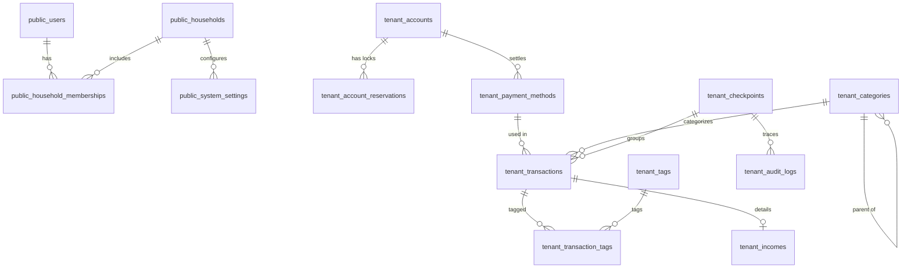

# 『Komame』データベース詳細設計書

## 1. スキーマ分離構成

PostgreSQL 16 内で、プラットフォーム共通の `public` スキーマと世帯ごとの専用スキーマ `tenant_{household_id}` に完全分離。

---

## 2. ER ダイアグラム

---

## 3. テーブル定義

### 3.1 マスタスキーマ (`public`)

#### 1. `public.users` (グローバル認証ユーザー)
| カラム名 | 型 | 制約 | 説明 |
| :--- | :--- | :--- | :--- |
| `id` | VARCHAR(64) | PK | ユーザーID (`usr_xxx` または `usr-xxx`) |
| `email` | VARCHAR(255) | UNIQUE, NOT NULL | メールアドレス (ログインID) |
| `password_hash` | VARCHAR(255) | NOT NULL | Argon2id ハッシュ化パスワード |
| `theme_preference` | VARCHAR(50) | DEFAULT 'natural_komame' | 選択中テーマ |
| `is_super_admin` | BOOLEAN | DEFAULT FALSE, NOT NULL | 最上位管理者フラグ |
| `is_active` | BOOLEAN | DEFAULT TRUE, NOT NULL | アカウント有効状態 |
| `created_at` | TIMESTAMPTZ | DEFAULT NOW(), NOT NULL | 作成日時 |
| `updated_at` | TIMESTAMPTZ | DEFAULT NOW(), NOT NULL | 更新日時 |

#### 2. `public.households` (世帯マスター)
| カラム名 | 型 | 制約 | 説明 |
| :--- | :--- | :--- | :--- |
| `id` | VARCHAR(64) | PK | 世帯ID (`hh_xxx`) |
| `name` | VARCHAR(100) | NOT NULL | 世帯名 (例: 「山田家」) |
| `schema_name` | VARCHAR(63) | UNIQUE, NOT NULL | PostgreSQL専用スキーマ名 (`tenant_xxx`) |
| `created_at` | TIMESTAMPTZ | DEFAULT NOW(), NOT NULL | 開設日時 |

#### 3. `public.household_memberships` (世帯所属・先行N:M互換)
| カラム名 | 型 | 制約 | 説明 |
| :--- | :--- | :--- | :--- |
| `id` | VARCHAR(64) | PK | 所属ID (`mem_xxx`) |
| `user_id` | VARCHAR(64) | FK(public.users.id) CASCADE, NOT NULL | ユーザーID |
| `household_id` | VARCHAR(64) | FK(public.households.id) CASCADE, NOT NULL | 世帯ID |
| `role` | VARCHAR(20) | NOT NULL | 権限 (`admin` / `member`) |
| `status` | VARCHAR(20) | DEFAULT 'active', NOT NULL | 状態 (`active` / `inactive`) |
| `is_default` | BOOLEAN | DEFAULT TRUE, NOT NULL | デフォルト所属フラグ |
| `joined_at` | TIMESTAMPTZ | DEFAULT NOW(), NOT NULL | 参加日時 |

#### 4. `public.system_settings` (世帯設定・ポリシー)
| カラム名 | 型 | 制約 | 説明 |
| :--- | :--- | :--- | :--- |
| `id` | VARCHAR(64) | PK | 設定ID |
| `household_id` | VARCHAR(64) | FK(public.households.id) CASCADE | 世帯ID |
| `key` | VARCHAR(50) | NOT NULL | キー名 (`currency_symbol`, `date_format`, `password_policy`) |
| `value_json` | JSONB | NOT NULL | 設定値 JSON |
| `updated_at` | TIMESTAMPTZ | DEFAULT NOW(), NOT NULL | 更新日時 |

---

### 3.2 テナント専用スキーマ (`tenant_{household_id}`)

#### 1. `accounts` (口座・資産・ウォレット)
| カラム名 | 型 | 制約 | 説明 | 削除ポリシー |
| :--- | :--- | :--- | :--- | :--- |
| `id` | VARCHAR(64) | PK | 口座ID (`acc_xxx`) | - |
| `name` | VARCHAR(100) | NOT NULL | 口座名 | - |
| `type` | VARCHAR(30) | NOT NULL | `bank`, `prepaid_wallet`, `cash`, `term_deposit`, `nisa_investment` | - |
| `balance` | BIGINT | DEFAULT 0, NOT NULL | 現在残高 (円) | - |
| `icon` | VARCHAR(50) | | アイコン識別子 | - |
| `color` | VARCHAR(20) | | カラーコード | - |
| `sort_order` | INT | DEFAULT 0, NOT NULL | 並び順 | - |
| `is_active` | BOOLEAN | DEFAULT TRUE, NOT NULL | 有効フラグ | **論理削除 (falseで非表示)** |
| `created_at` | TIMESTAMPTZ | DEFAULT NOW(), NOT NULL | 作成日時 | - |

#### 2. `account_reservations` (口座内バーチャル貯蓄・資金色分け)
| カラム名 | 型 | 制約 | 説明 |
| :--- | :--- | :--- | :--- |
| `id` | VARCHAR(64) | PK | 取り分け設定ID (`res_xxx`) |
| `account_id` | VARCHAR(64) | FK(accounts.id) CASCADE, NOT NULL | 対象口座ID |
| `name` | VARCHAR(100) | NOT NULL | 目的名 (例: 車検費用, 生活防衛資金) |
| `amount` | BIGINT | NOT NULL | ロック金額 (円) |
| `color` | VARCHAR(20) | | 表示カラー |
| `note` | TEXT | | メモ |
| `created_at` | TIMESTAMPTZ | DEFAULT NOW(), NOT NULL | 作成日時 |

> **計算式**: `実質利用可能残高 = accounts.balance - SUM(account_reservations.amount)`

#### 3. `payment_methods` (決済手段マスター)
| カラム名 | 型 | 制約 | 説明 | 削除ポリシー |
| :--- | :--- | :--- | :--- | :--- |
| `id` | VARCHAR(64) | PK | 決済手段ID (`pm_xxx`) | - |
| `name` | VARCHAR(100) | NOT NULL | 決済手段名 | - |
| `type` | VARCHAR(30) | NOT NULL | `cash`, `credit_card`, `debit_card`, `qr_code`, `direct_debit` | - |
| `source_account_id` | VARCHAR(64) | FK(accounts.id) SET NULL | 引き落とし元口座ID | - |
| `closing_day` | INT | | 締め日 (1〜28, 99:月末) | - |
| `withdrawal_day` | INT | | 引き落とし日 (1〜28, 99:月末) | - |
| `withdrawal_month_offset` | INT | DEFAULT 1, NOT NULL | 引き落とし月オフセット (0:当月, 1:翌月, 2:翌々月) | - |
| `is_active` | BOOLEAN | DEFAULT TRUE, NOT NULL | 有効フラグ | **論理削除 (falseで非表示)** |

#### 4. `categories` (費目マスター)
| カラム名 | 型 | 制約 | 説明 | 削除ポリシー |
| :--- | :--- | :--- | :--- | :--- |
| `id` | VARCHAR(64) | PK | 費目ID (`cat_xxx`) | - |
| `name` | VARCHAR(100) | NOT NULL | 費目名 | - |
| `parent_id` | VARCHAR(64) | | 親費目ID (階層分類用) | - |
| `icon` | VARCHAR(50) | | アイコン (絵文字など) | - |
| `color` | VARCHAR(20) | | カラーコード | - |
| `sort_order` | INT | DEFAULT 0, NOT NULL | ソート順 | - |
| `is_archived` | BOOLEAN | DEFAULT FALSE, NOT NULL | アーカイブフラグ | **論理削除 (trueで非表示)** |

#### 5. `checkpoints` (24時間リバート用チェックポイント)
| カラム名 | 型 | 制約 | 説明 |
| :--- | :--- | :--- | :--- |
| `id` | VARCHAR(64) | PK | チェックポイントID (`cp_xxx`) |
| `user_id` | VARCHAR(64) | NOT NULL | 操作ユーザーID |
| `description` | TEXT | | 操作概要 |
| `created_at` | TIMESTAMPTZ | DEFAULT NOW(), NOT NULL | 作成日時 |
| `expires_at` | TIMESTAMPTZ | NOT NULL | 有効期限 (`created_at + 24時間`) |

#### 6. `transactions` (明細データ)
| カラム名 | 型 | 制約 | 説明 | 削除ポリシー |
| :--- | :--- | :--- | :--- | :--- |
| `id` | VARCHAR(64) | PK | 明細ID (`tx_xxx`) | - |
| `user_id` | VARCHAR(64) | NOT NULL | 登録ユーザーID | - |
| `type` | VARCHAR(20) | NOT NULL | `expense` (支出), `income` (収入), `transfer` (資金移動) | - |
| `date` | DATE | NOT NULL | 取引日 (YYYY-MM-DD) | - |
| `amount` | BIGINT | NOT NULL | 金額 (円) | - |
| `category_id` | VARCHAR(64) | FK(categories.id) SET NULL | 費目ID | - |
| `payment_method_id` | VARCHAR(64) | FK(payment_methods.id) SET NULL | 決済手段ID | - |
| `from_account_id` | VARCHAR(64) | FK(accounts.id) SET NULL | 移動元口座ID | - |
| `to_account_id` | VARCHAR(64) | FK(accounts.id) SET NULL | 移動先口座ID | - |
| `shop_name` | VARCHAR(150) | | 店舗・取引先名 | - |
| `note` | TEXT | | 簡易メモ (個数、レシート差異) | - |
| `is_settled` | BOOLEAN | DEFAULT FALSE, NOT NULL | 口座減額済フラグ | - |
| `scheduled_withdrawal_date` | DATE | | カード引き落とし予定日 | - |
| `checkpoint_id` | VARCHAR(64) | FK(checkpoints.id) SET NULL | チェックポイントID | - |
| `deleted_at` | TIMESTAMPTZ | | 削除日時 | **論理削除 (NULL以外で非表示)** |
| `created_at` | TIMESTAMPTZ | DEFAULT NOW(), NOT NULL | 登録日時 | - |
| `updated_at` | TIMESTAMPTZ | DEFAULT NOW(), NOT NULL | 更新日時 | - |

#### 7. `incomes` (収入詳細)
| カラム名 | 型 | 制約 | 説明 |
| :--- | :--- | :--- | :--- |
| `id` | VARCHAR(64) | PK | 収入詳細ID |
| `transaction_id` | VARCHAR(64) | UNIQUE, FK(transactions.id) CASCADE, NOT NULL | 親明細ID |
| `gross_amount` | BIGINT | NOT NULL | 額面給与 (円) |
| `tax_deduction` | BIGINT | DEFAULT 0, NOT NULL | 税金・社保控除合計 (円) |
| `net_amount` | BIGINT | NOT NULL | 手取り金額 (円) |
| `is_temporary` | BOOLEAN | DEFAULT FALSE, NOT NULL | 臨時収入フラグ |

#### 8. `tags` & `transaction_tags` (タグ管理)
- `tags`: `id`, `name`, `color`
- `transaction_tags`: `transaction_id`, `tag_id` (複合主キー)

#### 9. `drafts` (2段階一時保存)
| カラム名 | 型 | 制約 | 説明 |
| :--- | :--- | :--- | :--- |
| `id` | VARCHAR(64) | PK | 下書きID (`draft_xxx`) |
| `user_id` | VARCHAR(64) | NOT NULL | 保存ユーザーID |
| `draft_type` | VARCHAR(20) | NOT NULL | `manual` (手動) / `auto` (自動) |
| `form_type` | VARCHAR(30) | NOT NULL | `single`, `shop_batch`, `category_batch` |
| `payload_json` | JSONB | NOT NULL | フォーム入力値 JSON |
| `item_count` | INT | DEFAULT 1, NOT NULL | 入力件数 |
| `saved_at` | TIMESTAMPTZ | DEFAULT NOW(), NOT NULL | 保存日時 |

#### 10. `savings_goals` (貯蓄目標)
- `id`, `title`, `target_amount`, `target_date`, `account_ids_json`, `color`, `is_completed`, `created_at`

#### 11. `notifications` (アプリ内通知)
- `id`, `user_id`, `type`, `title`, `message`, `is_read`, `created_at`

#### 12. `audit_logs` (監査ログ)
- `id`, `user_id`, `operator_user_id`, `action` (`CREATE`/`UPDATE`/`DELETE`/`REVERT`), `entity_type`, `entity_id`, `summary`, `before_data_json`, `after_data_json`, `checkpoint_id`, `created_at`
